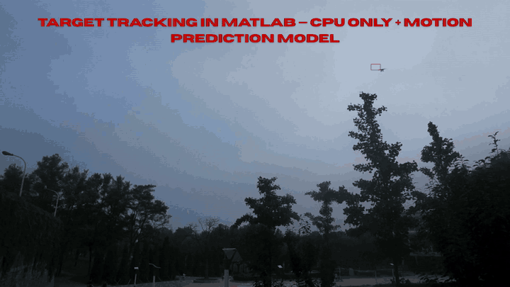

# YOLO Object Tracking with Motion Prediction

Real-time single-UAV tracking in MATLAB that combines **two YOLOv8 models** with an **adaptive Kalman filter**. It was developed as part of the Master's thesis *"Experimental Implementation of an Autonomous UAV with AI-Based Visual Servoing"*, where the tracker provides the visual feedback needed to follow a target UAV.



> Full video: [`Tracking example.mp4`](<videos/Tracking example.mp4>)

## Overview

Running a large detector on every frame is too slow for a low-power computer. This project splits the work between two models and uses motion prediction to fill the gaps:

| Component | Role |
|-----------|------|
| **Detection model** (`best_640_8.onnx`, 640×640) | Runs on the full frame to find the UAV at the start or after losing it. |
| **Tracking model** (`best_320_8.onnx`, 320×320) | Runs on a small crop centered on the predicted position, so it is much faster. |
| **Kalman filter** (2D constant velocity) | Smooths the trajectory and predicts the position between inferences or while the target is lost. Its noise parameters adapt to the target speed. |

Inference runs asynchronously on parallel workers (`parfeval`), so the video keeps playing at its real frame rate while the models compute.

## How it works

1. **Detection**: the heavy model searches the full frame.
2. **Confirmation**: the detection must be confirmed over consecutive frames before tracking starts (yellow box). This filters out false positives.
3. **Tracking**: the fast model runs on a crop centered on the Kalman prediction, and every measurement corrects the filter (red box).
4. **Loss handling**: if the target is missed, the Kalman filter keeps predicting for a few frames. If it is not recovered, the box freezes (green box) while the detector searches the full frame again.

| Box color | State |
|-----------|-------|
| Yellow | Confirming a new detection |
| Red | Tracking (measurement + Kalman correction) |
| Green | Target lost, last predicted position frozen |

## Results

| Metric | Value |
|--------|-------|
| Inference rate of the tracking model | **5.91 FPS** |
| Mean center error | **21.864 px** |

The error is the mean Euclidean distance between the predicted and ground-truth bounding box centers.

These results were obtained on a modest machine: a **2015 MacBook Pro with a 2.7 GHz dual-core Intel Core i5**, CPU only and with two parallel workers. Performance should improve noticeably on newer hardware or with a GPU.

## Training data

Both models were trained to detect UAVs using the [DUT Anti-UAV](https://github.com/wangdongdut/DUT-Anti-UAV) dataset.

## Requirements

- MATLAB with the following toolboxes:
  - Deep Learning Toolbox
  - Deep Learning Toolbox Converter for ONNX Model Format
  - Computer Vision Toolbox
  - Parallel Computing Toolbox

## Usage

1. Clone the repository and open MATLAB in the project folder (it must be the current folder, since the script uses `pwd`):
   ```bash
   git clone https://github.com/davribsan/YOLO-object-tracking-with-motion-prediction.git
   ```
2. Put your video in the `videos/` folder and set its name in `videoPath` (section 1 of `object_tracking.m`).
3. Run `object_tracking.m`.

The script starts a parallel pool with two workers, loads each model on its own worker, and then plays the video with the tracking overlay.

## Configuration

The main parameters are defined at the top of `object_tracking.m`:

| Parameter | Default | Effect |
|-----------|---------|--------|
| `imageSizeDetection` | 640 | Input size of the detection model. |
| `imageSizeTracking` | 320 | Input size (and crop size) of the tracking model. |
| `minConfirmCount` | 2 | Consecutive detections needed to confirm a target. |
| `maxMisses` | 5 | Missed tracking inferences before going back to detection. |
| `maxPredFrames` | 10 | Frames predicted by the Kalman filter alone before the box freezes. |

The Kalman process and measurement noise (`adaptiveQ`, `adaptiveR`) are adjusted automatically depending on the estimated target speed: faster targets rely more on the YOLO measurement, slower ones are smoothed more.

## Project structure

```
.
├── object_tracking.m   % main script
├── Models/             % ONNX models: best_640_8 (detection), best_320_8 (tracking)
├── Classes/            % YOLOv8 wrappers and custom split layer
├── Functions/          % model import, inference and parallel worker
├── +utils/             % pre/post-processing (DFL, anchors, NMS...)
└── videos/             % your input videos (not tracked by Git)
```

## Acknowledgments

- [DUT Anti-UAV](https://github.com/wangdongdut/DUT-Anti-UAV) for the training dataset.
- Parts of the YOLOv8 ONNX import and pre/post-processing code are based on code from MathWorks (*Copyright 2024 The MathWorks, Inc.*).

## Author

**David Ribeiro Sanjorge**
Master's thesis: *Experimental Implementation of an Autonomous UAV with AI-Based Visual Servoing*.

## License

No license has been specified for this project. All rights are reserved by the author.
